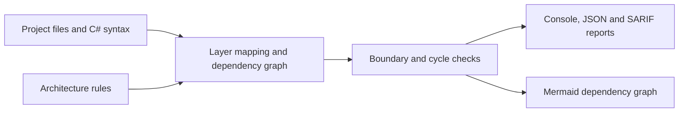

# ArchRules: making architecture rules executable

[Portfolio](../README.md) · [Source and setup](https://github.com/fbsilvadev/archrules-dotnet)

## Problem

A solution can have projects called Domain, Application and Infrastructure while still allowing dependencies that contradict its intended architecture. Reviewing every project reference and namespace import manually gets harder as the solution grows.

## Design decisions

ArchRules reads project references from project XML and parses C# syntax with Roslyn. A rules file maps projects to layers and defines allowed dependencies. The analyzer checks those boundaries and detects cycles.

The deterministic core is separate from the CLI. Reports use stable ordering, and violations affect the exit code. An optional explanation adapter can add commentary without changing the findings.

## Trade-offs

Parsing without a build makes the tool useful before restoring or compiling the target solution. It also means the analysis is based on syntax and project XML rather than full MSBuild evaluation or semantic compilation. Conditional references and dependencies resolved at runtime need separate review.

## Evidence to inspect

- The sample solution contains an intentional violation.
- Report examples show JSON, SARIF and dependency graphs.
- The test suite covers rule parsing, dependency analysis, cycle detection and report formats.

These materials are in the linked source repository. This case study does not add a performance benchmark or claim complete dependency detection.

## Engineering lesson

Architecture decisions become easier to maintain when they can be checked repeatedly and produce findings a developer can locate and act on.
