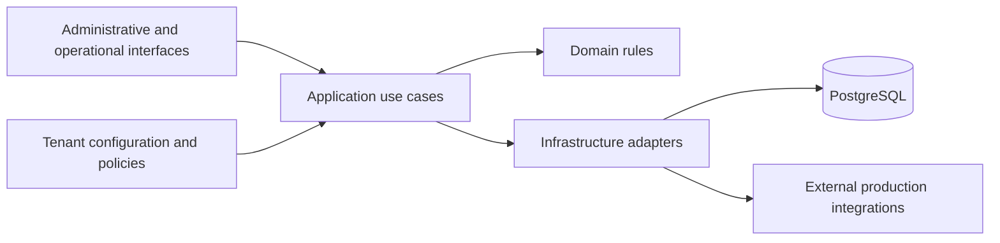

# CredentialPlatform: separating shared rules from tenant configuration

[Portfolio](../README.md)

**Status:** under development. Source code is private. This is a selected architecture summary as of October 2026.

## Problem

A credential platform must support different organizations, document types, visual identities and production integrations. Copying the application for each organization makes changes harder to propagate and audit.

## Architecture approach

The platform uses a shared .NET application with explicit tenant context. Variable behavior belongs in configuration, policies, templates and integration adapters. Domain rules remain independent of a particular customer or production provider.

The architecture separates domain rules, application use cases, infrastructure adapters and entry points. ASP.NET Core, EF Core and PostgreSQL support the backend; Angular supports administrative and operational interfaces.

This diagram describes responsibility boundaries. It is not an inventory of deployed services.

## Decisions that shape the work

- Keep tenant-specific names and provider details outside shared domain rules.
- Treat authorization and tenant context as separate requirements at each entry point.
- Preserve credential history instead of replacing records in place.
- Distinguish a public verification outcome from access to a person's underlying data.
- Define asynchronous work with idempotency, retry, failure handling and traceability in mind.

## Trade-offs and current limits

Configuration increases reuse but adds combinations to validate. Isolation cannot be established by a UI filter alone; application behavior and persistence need corresponding checks.

The product and its validation are still evolving. This case does not claim that every planned capability is delivered, that every deployment scenario is verified or that the platform is production ready.

## Engineering lesson

A reusable platform needs an explicit distinction between business invariants and choices that legitimately vary by organization.
