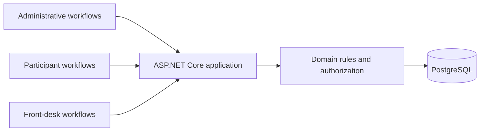

# Jano: keeping event operations focused

[Portfolio](../README.md)

**Status:** under development. Source code is private. This is a selected architecture summary as of October 2026.

## Problem

Event operations involve different responsibilities. Administrative work, participant access and front-desk tasks need different information and permissions. A single broad view can expose more data than an operator needs.

## Architecture approach

Jano uses ASP.NET Core, Razor Pages, EF Core and PostgreSQL. Server-rendered pages and local htmx assets support focused interactions without making a separate single-page application a prerequisite.

This is a conceptual view of responsibilities, not a network or deployment diagram.

## Decisions that shape the work

- Restrict front-desk views to the information needed for that operation.
- Keep credentials and operational secrets out of public material.
- Apply business changes through explicit specifications and verification.
- Keep development configuration distinct from event deployment configuration.
- Reuse interface tokens and components across workflows.

## Trade-offs and current limits

Server-rendered interactions reduce the number of moving parts but still require careful handling of authorization, validation and state changes. Local assets reduce dependence on external CDNs while making asset maintenance part of the application.

The commercial platform foundation and access lifecycle remain in development. This summary does not assert production readiness or disclose operational volumes, participant data or deployment settings.

## Engineering lesson

The data a workflow needs should determine its access boundary. A front-desk task should not inherit the visibility of an administrator merely because both use the same application.
