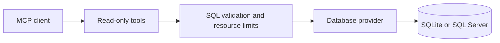

# MCP SQL Read-only: enforcing database access boundaries

[Portfolio](../README.md) · [Source and setup](https://github.com/fbsilvadev/mcp-sql-readonly-dotnet)

## Problem

An agent that explores a database needs schema information and query results. It should not receive write access merely because it can generate SQL.

## Design decisions

The .NET MCP server exposes table discovery, schema inspection, queries and sample rows over stdin/stdout. Database providers sit behind an interface; query checks and resource limits are applied before returning results.

SQLite connections are forced into read-only mode. SQL Server requires an account with appropriate read permissions: a query validator does not replace database authorization. Row caps and timeouts bound the work exposed through the tools.

## Trade-offs

Read-only access prevents writes only when the database permissions enforce it. It can still expose sensitive information or run expensive queries. Views and grants must match the intended data scope, and results passed to a model provider cross a data boundary.

The server supports SQLite and SQL Server. Support for other providers is separate work.

## Evidence to inspect

- A sample SQLite database and documented MCP calls.
- Provider tests that attempt writes while bypassing the query guard.
- Tests for query rejection, result truncation, cancellation and timeout behavior.
- Opt-in SQL Server integration tests with their setup requirements.

The repository documents these checks and their limits; this summary does not assert that a customer's database has been audited.

## Engineering lesson

The strongest boundary belongs at the resource that must be protected. Validation and protocol hints support database permissions; they do not replace them.
